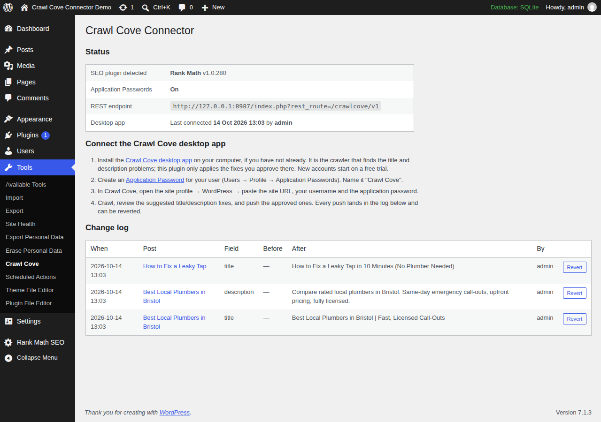

# Crawl Cove Connector: WordPress SEO Plugin for Bulk Title & Meta Description Fixes

The official WordPress companion plugin for [Crawl Cove](https://crawlcove.com/?utm_source=wordpress-plugin&utm_medium=referral&utm_campaign=github-readme), the desktop SEO crawler. Push approved page title and meta description fixes from your SEO audit straight into **Yoast SEO**, **Rank Math**, **SEOPress** or **All in One SEO (AIOSEO)**, with a full change log and one-click revert.

Crawl your site, review the suggested fixes in the app, push the ones you approve. No CSV exports, no spreadsheets, no copy-pasting into the post editor one page at a time.



## Why this plugin exists

Every SEO crawler can find missing, duplicate, too-long or too-short titles and meta descriptions. Almost none of them can fix any of it. The usual workflow is: export a CSV, open each post in the WordPress editor, find the SEO plugin's meta box, paste, save, repeat a few hundred times.

Crawl Cove Connector closes that loop. The [Crawl Cove desktop crawler](https://crawlcove.com) sends the fixes you approved to your site over the WordPress REST API, and this plugin writes them into the native fields of whichever SEO plugin you already use. Nothing is duplicated or overridden at render time; your SEO plugin keeps working exactly as before, just with better values.

The plugin is free. The Crawl Cove desktop app it works with is a paid crawler that starts with a free trial, no card needed: see [Crawl Cove pricing](https://crawlcove.com/pricing?utm_source=wordpress-plugin&utm_medium=referral&utm_campaign=github-readme).

## Features

- **Bulk-apply title and meta description fixes** approved in the Crawl Cove app, in batches, with per-item results.
- **More than titles** (0.11): canonical URLs, index/noindex and Open Graph/Twitter fields; links to a redirect repointed to the final URL (or unlinked) across post content, Elementor data and menus; image alt text on the media library image and the page; four admin-only hardening switches (XML-RPC, generator tag, security headers, uploads listing).
- **Works with the four major WordPress SEO plugins**: Yoast SEO, Rank Math, SEOPress and AIOSEO. The connector detects which one is active and writes its native fields.
- **Full change log with one-click revert**: every write records the previous value. Undo any change from **Tools → Crawl Cove** or from the app. The log keeps the most recent 1,000 entries (a title and a description on one post are two); once it is full, each new push drops the oldest entries, already-reverted ones first, and the Tools page says so.
- **Dry-run mode** shows exactly what would change before anything is written.
- **Authentication via WordPress core Application Passwords**: no extra accounts, no API keys stored by the plugin, revoke access any time from your user profile.
- **Respects WordPress permissions**: a connected user can only change posts they are allowed to edit (`edit_post` checked per post).
- **Private by design**: no external requests, no tracking, no data leaves your site. The plugin only receives what you send it.
- **Small and auditable**: plain GPL PHP with no framework or dependencies, unit- and integration-tested, PHPCS-clean against WordPress-Extra and WordPress-Docs.

## How it works

The plugin registers a REST API under `crawlcove/v1` (auth: WordPress core Application Passwords):

| Route | Method | Purpose |
|---|---|---|
| `/status` | GET | Plugin + detected SEO plugin info |
| `/resolve` | POST | Map crawled URLs to posts, return current title/description |
| `/apply` | POST | Apply a batch of reviewed fixes (`dry_run` supported) |
| `/replace-urls` | POST | Repoint, unlink or un-nofollow links to one URL in a page or across the site (`dry_run` supported; needs no SEO plugin) |
| `/image-alt` | POST | Set an image's alt text on the media library image and in the page that shows it (`dry_run` supported; needs no SEO plugin) |
| `/site-settings` | POST | Switch site hardening settings on or off: XML-RPC, generator tag, security headers, uploads listing (administrators only) |
| `/changes` | GET | The change log (entries this user may edit; all of it for an administrator) |
| `/revert` | POST | Restore a change's previous value (refused if the value has changed since, unless `force`) |

Safety model:

- Nothing is written that wasn't sent by an authenticated user with the right capability for that specific target: `edit_post` for a post/page (of a type with a public page, so never a privacy request or revision), `manage_options` for the homepage, `edit_term` for a taxonomy term. Only SEO fields are written; the post itself is never re-saved.
- Nothing is read back that the user could not read in WordPress itself: `/resolve` answers `ccc_unresolvable` (the same reply as a missing post) for a post the user may not `read_post` (another user's draft or private post) or whose type has no public page (a privacy request, a reusable block), and `/changes` lists only the entries on targets the user may edit (administrators, `manage_options`, see the whole log).
- Values are sanitized and length-capped; batches are capped at 50 changes. Sanitizing strips tags and collapses whitespace but keeps SEO template variables (`%category%`, `%%date%%`) exactly as sent. Core `sanitize_text_field()` would delete `%ca`, `%da` and any other `%` plus two hex digits. SEOPress and AIOSEO still run core sanitizing in their own savers, so on those sites only their native variables (`%%post_title%%`, `#post_title`) survive, the same as in their editors.
- Every write records the previous value; revert from the app or from **Tools → Crawl Cove**. A revert never silently overwrites a newer value: if the field no longer holds what that change wrote, nothing is written.
- Empty string means "remove the override, fall back to the SEO plugin's template".
- No external requests, no tracking, no data leaves the site.

### When the site cannot accept Application Passwords at all

WordPress core only enables Application Passwords when `is_ssl()` is true or
`WP_ENVIRONMENT_TYPE` is `local` (`wp_is_application_passwords_supported()`):
every plain-http staging/local site and every HTTPS site behind a proxy that
does not pass the scheme through. On such a site core ignores the Basic auth
header, the request arrives anonymous, and WordPress alone would answer a
generic `rest_forbidden` 401 that looks exactly like a wrong password.

The same state has a second, common cause on sites that ARE on HTTPS: a
plugin or theme filtering `wp_is_application_passwords_available` to false.
Wordfence does this by default (its "Disable WordPress application
passwords" option, under Firewall, All Firewall Options, ships switched
on). The plugin tells the two apart with core's
`wp_is_application_passwords_supported()`: if core would allow them here, a
filter turned them off, and the message names that cause instead of HTTPS.

Every route therefore answers an anonymous request on such a site with its
own error, before any credential is judged (same code for both causes; only
the message differs):

```json
{"code":"ccc_app_passwords_unavailable","message":"Application Passwords are switched off on this WordPress site, ...","data":{"status":401}}
```

The client should show that message as the site's problem, not the user's
credentials, and point at **Tools → Crawl Cove** on the site, whose Status
table shows the same state with the fix (proxy: set `HTTPS` from
`HTTP_X_FORWARDED_PROTO` in `wp-config.php`; last resort: the
`wp_is_application_passwords_available` filter; on an HTTPS site, the
security plugin's setting instead). A genuine bad username or
password on a site where they ARE enabled still comes back as core's own
401 without this code: `incorrect_password` (or similar) when core gets to
report it, or a bare `rest_forbidden` when another plugin determined the
current user before the REST server did, which hides core's reason.

### Finding the REST root (do not hard-code `/wp-json/`)

WordPress serves its REST API at one of three URL shapes, chosen by the
site's permalink setting, and the plugin's routes live under whichever one
the site uses:

| Permalink setting | REST root | `/status` for example |
|---|---|---|
| Pretty (`/%postname%/` etc.) | `https://example.com/wp-json/` | `https://example.com/wp-json/crawlcove/v1/status` |
| Pretty, index-style (IIS, some nginx) | `https://example.com/index.php/wp-json/` | `https://example.com/index.php/wp-json/crawlcove/v1/status` |
| Plain (`?p=123`, the WordPress default) | `https://example.com/index.php?rest_route=/` | `https://example.com/index.php?rest_route=/crawlcove/v1/status` |

A client that only builds `<site>/wp-json/crawlcove/v1/...` works on the
first row only. On a plain-permalink site that URL is not routed to
WordPress at all: Apache returns its own HTML 404 and a `php -S` or
misconfigured host returns the HTML front page with a 200, so "install the
plugin" or "could not reach that site" would be the wrong diagnosis. The
plugin is installed and fine; the client asked the wrong URL.

Discover the root instead. Every WordPress front-end response carries a
`Link` header naming it, so one unauthenticated request to the site URL is
enough:

```
GET https://example.com/
Link: <https://example.com/index.php?rest_route=/>; rel="https://api.w.org/"
```

Use that root plus `crawlcove/v1/<route>`. When the root ends in `?rest_route=/`
the route is appended to the query value (`?rest_route=/crawlcove/v1/status`),
never as a second path. If the `Link` header is missing (a security plugin
can strip it), try `<site>/wp-json/crawlcove/v1/status` and then
`<site>/index.php?rest_route=/crawlcove/v1/status`, and treat any 2xx whose
body is not JSON as "not the REST API", not as success. The
`?rest_route=` form works on every permalink setting, so it is the safe last
resort. The integration harness checks the `Link` header and the route under
it on both the plain and the pretty permalink setting
(`tests/integration/rest-root-checks.sh`).

### The homepage target (`post_id: 0`)

A site with no static front page set (Settings → Reading → **"Your latest posts"**)
has no post to hold a title/description override for `/`. Yoast and Rank Math each
keep it in their own settings instead. `/resolve` reports the site root as
`post_id: 0` in that case (a static front page still resolves to its own real
post id, exactly like any other page, so nothing changes there); pass `post_id: 0`
back to `/apply` or `/revert` to target it.

- **Supported adapters**: Yoast SEO, Rank Math and SEOPress. AIOSEO changes to
  `post_id: 0` fail with `ccc_home_unsupported`: the change is reported, not
  silently dropped. AIOSEO isn't just unresearched: its "homepage" title and
  description read the *same* site-wide template used to fill in every other
  page's title/description, so writing to it to "fix the homepage" would
  silently change titles across the whole site, not just `/`.
- **Capability**: `manage_options`, not `edit_post`. There is no post to check
  `edit_post` against, and Settings → Reading (where this value lives natively)
  already requires it.
- **Rank Math's homepage title cannot be cleared**: unlike every other
  title/description field in this plugin, an empty string sent for Rank Math's
  homepage title is rejected with `ccc_home_title_clear_unsupported` instead of
  being written. Verified against real Rank Math source: its homepage title has
  no fallback template applied at render time (an empty stored value renders as
  a literally empty `<title>` tag), unlike Yoast's homepage title/description and
  Rank Math's own homepage description, which do fall back safely. Set a new
  title instead of clearing it, or clear it from Rank Math's own settings page.
- Sending `post_id: 0` on a site that **does** have a static front page returns
  `ccc_no_homepage_target`; pass that page's own post id instead.
- On a Polylang site, `post_id: 0` can also carry an optional `lang` field
  to target a non-default language's own homepage (see
  [Multilingual sites](#multilingual-sites-polylang-wpml-etc) below).

### The taxonomy term target (a negative `post_id`)

A category, tag or custom-taxonomy archive (e.g. `/category/news/`) has no
post to hold a title/description override. Yoast, Rank Math and SEOPress
each keep per-term SEO data in their own storage instead. `/resolve` reports
a term archive URL as `post_id: -$term_id` (term ids are always positive, so
a negative number is unambiguous and free to repurpose, the same trick
`post_id: 0` already uses for the homepage); pass that same negative number
back to `/apply` or `/revert` to target it.

This is deliberately a **per-term** override, not the taxonomy's site-wide
default title *template* (Settings the SEO plugin itself exposes, e.g.
"Category archives" in Yoast's Search Appearance). A template change would
affect every term in that taxonomy at once, which is wrong for a fix aimed at
one crawled URL, so this plugin never touches it.

- **Supported adapters**: Yoast SEO, Rank Math and SEOPress. AIOSEO changes
  to a term fail with `ccc_term_unsupported`: the change is reported, not
  silently dropped. AIOSEO isn't just unresearched: its own source confirms
  per-term SEO fields are a Pro-only feature (`app/Common/Main/
  BulkActions.php`: "Pro only. The term analysis columns live on the Pro
  aioseo_terms table"), so nothing exists to write to in the free plugin
  this connector supports.
- **Capability**: `edit_term`, WordPress core's own meta capability for
  editing a specific term, since there is no post to check `edit_post`
  against.
  It maps through to the term's taxonomy (e.g. `manage_categories` for
  `category`/`post_tag`; a custom taxonomy can register its own capability
  type). Editor-role users have this by default; Author-role users do not.
- Sending a negative `post_id` with no matching term returns `ccc_no_term`.
- Unlike Rank Math's homepage title, clearing a term's title or description
  to `''` is safe for all three supported adapters: each falls back to the
  taxonomy's own default title template, verified against real source
  (Rank Math's `Paper\Taxonomy::title()`; Yoast's term-archive indexable
  presentation follows the same pattern as its homepage description;
  SEOPress's `TaxonomySpecification::getValue()` falls through to its own
  per-taxonomy default the same way).

See [SECURITY-NOTES.md](SECURITY-NOTES.md) for the full security pass (capability matrix, fuzzing, findings).

### WooCommerce products and categories

Nothing in this plugin special-cases a post type or taxonomy, so WooCommerce
products (`post_type: product`) and product categories (the `product_cat`
taxonomy, via the negative-`post_id` term target above) already work exactly
like any other post/page or category. This was verified against a real
WooCommerce install, not assumed from its being "just" a custom post type.

One real difference from ordinary posts: **WooCommerce only grants product
edit capabilities (`edit_products`, `edit_product_terms`, etc.) to the Shop
Manager and Administrator roles, not Editor** (confirmed against
WooCommerce's own `WC_Install::create_roles()` source). An Editor-role user
who can push fixes to ordinary posts/pages will get `ccc_forbidden` on
WooCommerce products/categories. Connect as a Shop Manager or Administrator
if you want those pushed too. This is WooCommerce's own capability model,
not a plugin limitation.

### Multilingual sites (Polylang, WPML, etc.)

Ordinary translated content works with zero special handling. A post's
translation is its own real post, with its own `post_id` and its own SEO
postmeta, so it resolves, applies and reverts exactly like any other post.
The same is true for a translated category/tag term (each language's term
is its own real `term_id`, so it already gets its own SEO title/description
via the negative-`post_id` target above).

**The "your latest posts" homepage is the one target with no post or term
of its own to hold a per-language value**, so it needs a small REST
contract addition: an optional `lang` field, sent alongside `post_id: 0`.

- `/resolve` reports a non-default language's homepage URL (for example
  `/fr/` under Polylang's directory URL mode) as `post_id: 0` with
  `lang: "fr"`. The default language's own homepage still reports
  `lang: ""`, exactly as before this field existed. (An earlier version
  either misresolved `/fr/` to the wrong internal target or, once that
  was fixed, reported it as `ccc_unresolvable`; both are now `post_id: 0`,
  see the changelog.) A static front page in another language is
  unaffected either way, since that's just an ordinary page with its own
  `post_id`.
- To push a fix, send that same `lang` back: `{"post_id": 0, "lang": "fr",
  "title": "..."}` on `/apply`/`/revert`. Omitting `lang` (or sending your
  site's own default language code) targets the plain/default-language
  homepage exactly as it always has. This is fully additive: nothing
  about the existing `post_id: 0` contract changed.
- **Supported adapters: Yoast SEO only.** Verified against Polylang's own
  source: it ships a dedicated compatibility module *only* for Yoast
  (`integrations/wpseo/`, registering `title-home-wpseo`/
  `metadesc-home-wpseo` with Polylang's own string-translation system).
  There is no such module for Rank Math, SEOPress or AIOSEO, because none
  of them has a per-language slot to put a value into: their homepage
  title/description is one value shared across every language, full stop.
  Sending `lang` to any of those three returns `ccc_language_unsupported`:
  reported, not silently written as a site-wide change nobody asked for.
- `lang` on any target other than `post_id: 0` returns
  `ccc_language_requires_home`. A `lang` that isn't one of the site's
  active Polylang language codes returns `ccc_no_such_language`; `lang`
  sent with no supported multilingual plugin active returns
  `ccc_multilingual_required`.
- Pushing a fix to the **default**-language homepage target (`lang`
  omitted) only ever affects your default language's title. It was verified
  against a real install that this does not corrupt or overwrite a
  non-default language's already-translated homepage title (Polylang's
  own string-translation system reattaches it to the new original string,
  the same mechanism `lang`-qualified writes use directly).

**TranslatePress is architecturally different from Polylang/WPML, and needs
no `lang` field at all.** It has no separate post or SEO storage per
language. It translates the SAME post's SAME Yoast/Rank Math/SEOPress/
AIOSEO postmeta at render time, by swapping the rendered *string* (its own
gettext-style dictionary, keyed on the literal original text). There is
nothing per-language for `lang` to mean here, so it's simply never sent or
returned for a TranslatePress site.

- A URL under TranslatePress's language prefix (e.g. `/fr/some-post/`, or
  the `/fr/` homepage) resolves to the exact same target (the same
  `post_id`, or `HOME_ID`) as its default-language counterpart, verified
  end-to-end against a real install. Confirmed against TranslatePress's own
  source that this is safe rather than assumed: it manages the language
  prefix with plain string manipulation (`includes/class-url-converter.php`),
  not a WordPress rewrite rule (there is no `add_rewrite_rule()` call
  anywhere in the plugin), so there is no Polylang-style risk of colliding
  with a real (or internal) taxonomy's own rewrite rule.
- Before this was handled, EVERY URL under a non-default language's prefix
  was `ccc_unresolvable`: not a homepage-only gap, but every translated post,
  page, and term archive on the whole site. See the 0.10.0 changelog entry.
- One consequence of TranslatePress's design, not a CCC bug: because its
  translation lookup is keyed on the literal original string, any edit to
  that string (from this plugin, or from a site owner's own hand-edit in
  the SEO plugin's metabox, no difference) orphans whatever translation
  already existed for the old string until a human re-translates it in
  TranslatePress's own editor.

### Capabilities (`/status`)

`/status` carries `capabilities`, the fix kinds this install can apply:
`title`, `description`, `canonical`, `robots` and `social` (only while a
supported SEO plugin is active), `replace_urls`, `site_settings` and
`image_alt` (always). `/status` also carries
`site_settings`, the current value of each switch. A connector older than 0.11 sends no list at all,
which means title and description only. Gate each fix kind on its name and
ignore names you do not know.

### Canonical, robots and social fields (`/apply`)

Since 0.11 a change item on an ordinary post or page can carry, next to
`title` and `description`:

| Field | Value | Capability |
|---|---|---|
| `canonical` | absolute http(s) URL, `""` clears | `canonical` |
| `robots_index` | `true` index, `false` noindex, `null` back to the SEO plugin's default for the post type | `robots` |
| `og_title`, `og_description` | text, same caps as title (512) and description (1,024) | `social` |
| `og_image` | absolute http(s) URL, `""` clears | `social` |
| `twitter_title`, `twitter_description` | text, same caps | `social` |

Each field is its own entry in `applied` and in the change log (`field` is
the name above; `robots_index` logs `""`, `"index"` or `"noindex"`), with the
same `from`/`to`/`changed`/`change_id` shape and the same revert rules as a
title. A URL that is not absolute http(s) answers `ccc_bad_url`; a
`robots_index` that is not a boolean or null answers `ccc_bad_value`; any of
these fields on the homepage (`post_id` 0) or a term answers
`ccc_field_unsupported` (title and description still work there).

Where each plugin keeps them, confirmed in its source: Yoast
`_yoast_wpseo_canonical`, `_yoast_wpseo_meta-robots-noindex` (`1` noindex,
`2` index), `_yoast_wpseo_{opengraph,twitter}-{title,description}`,
`_yoast_wpseo_opengraph-image` (+ `-image-id`); Rank Math
`rank_math_canonical_url`, `rank_math_robots` (a token array, other
directives kept), `rank_math_facebook_*`, `rank_math_twitter_*` (and
`rank_math_twitter_use_facebook` off, or Rank Math serves the Facebook values
on Twitter); SEOPress `_seopress_robots_canonical`, `_seopress_robots_index`
(`yes` = noindex; SEOPress has no explicit "index", so `true` reads back as
the default `""`), `_seopress_social_fb_*`, `_seopress_social_twitter_*`;
AIOSEO's `aioseo_posts` columns through its `savePost()` patch API
(`canonical_url`, `robots_default`/`robots_noindex`, `og_*` with
`og_image_type` `custom_image`, `twitter_*` with `twitter_use_og` off). All
three of Yoast, Rank Math and SEOPress leave the canonical tag out of a
noindex page, so a push of both shows only the noindex.

### Replacing links (`/replace-urls`)

For a link to a redirect (point it at the final URL), a broken link (point it
elsewhere, or unlink it) or a nofollowed internal link. Request:

```json
{"dry_run": true, "changes": [
  {"url": "https://example.com/about/", "from": "https://example.com/old/",
   "to": "https://example.com/new/", "scope": "page"},
  {"from": "https://example.com/gone/", "unlink": true, "scope": "site"},
  {"url": "https://example.com/blog/", "from": "https://example.com/team/",
   "to": "https://example.com/team/", "rel_strip": "nofollow", "scope": "page"}
]}
```

- `from` and `to` are absolute http(s) URLs with no quotes, angle brackets,
  backslashes, backticks or spaces (`ccc_bad_url`; a forced revert writes
  `from` back, so it gets the same rules). `from` also matches its
  root-relative form (`/old/`) when it is on this site, except the bare
  homepage `/`. Attributes are read in order the way a browser does, so
  `href=` inside another attribute's value is never taken for a link. Only exact
  matches are changed, and only where a URL belongs: `href`, `src`, `srcset`
  and `poster` values, CSS `url()`, whole JSON string values in Gutenberg
  block comments and Elementor data, and a menu item's URL. `/old/` never
  touches `/old/two/`, and the URL written as plain text is left alone.
- `scope: "page"` (the default) needs `url` (or `post_id`) of the page that
  holds the link and `edit_post` on it; it edits that post's content and its
  Elementor data. A homepage or archive URL answers `ccc_no_content_target`.
- `scope: "site"` searches every public post type (drafts, pending,
  scheduled and private posts included), Elementor data, classic menu custom
  links and block theme `wp_navigation` menus, but only where this user may
  edit: `edit_post` per post, `edit_theme_options` for menus. More than 200
  places answers `ccc_too_many_targets`.
- `unlink: true` removes the `<a>` tags and keeps their text. Gutenberg
  buttons are left alone (a button without a link is an invalid block) and
  counted in `skipped`. Menus are not unlinked.
- `rel_strip: "nofollow"` removes `nofollow` from the matching anchors' `rel`
  (dropping `rel` if it ends up empty). With `to` equal to `from`, that is
  all it does.
- `from` equal to `to` without `rel_strip` answers `ccc_nothing_to_do`.

Reply, one item per change, in order:

```json
[{"index": 0, "ok": true, "dry_run": false, "scope": "page", "post_id": 12,
  "from": "https://example.com/old/", "to": "https://example.com/new/",
  "unlink": false, "changed": true, "count": 3, "skipped": 0,
  "locations": [{"where": "content", "count": 2}, {"where": "elementor", "count": 1}],
  "posts": [{"post_id": 12, "locations": [{"where": "content", "count": 2},
                                          {"where": "elementor", "count": 1}]}],
  "change_id": 41}]
```

`where` is `content`, `elementor`, `menu` (a classic menu item; its
`post_id` is the menu item's) or `navigation` (a block theme menu). `count`
is how many URLs changed; `count: 0` with `changed: false` is a valid answer
(the link was not found) and logs nothing. `post_id` is present for page
scope only. A refused item is `{"index", "ok": false, "error", "message"}`.
`change_id` is present only after a real write: a site-wide change is ONE log
entry, so one `/revert` undoes all of it.

Content is written straight to the row, never re-saved through
`wp_update_post()`, so kses never touches an admin's embeds and the modified
date is unchanged. Changed posts get the per-post cache purge; a menu change
gets the full purge (menus are on every page). Elementor's element and CSS
caches for the post are dropped so it re-renders.

Revert puts back the exact original bytes as long as every location still
holds exactly what the change left there. If any was edited since, nothing is
written and it answers 409 `ccc_value_changed` with `data.post_ids` (the
edited posts). With `force` the edited locations get the new URL rewritten
back to the old one and the rest are restored exactly; a place that no
longer exists is skipped. A forced revert answers 409 `ccc_content_changed`
(show its message, nothing was written) when it could not be exact: an
unlink or nofollow strip, or an edited place that already linked to the new
URL before the change (those links cannot be told apart from the changed
ones).

### Image alt text (`/image-alt`)

```json
{"dry_run": false, "changes": [
  {"url": "https://example.com/about/", "src": "https://example.com/wp-content/uploads/2026/10/door-300x225.jpg",
   "alt": "A red front door"}]}
```

`url` is the page that shows the image, `src` the image URL from the crawl
(a resized copy such as `-300x225` or core's `-scaled` copy finds its
original), `alt` at most 250 characters, tags stripped. An empty `alt` marks
the image decorative and is written as `alt=""`, never dropped. One change
sets both places WordPress keeps alt text:

- the media library image's alt (`_wp_attachment_image_alt`), which page
  builders and new insertions read, if `src` is a media library image and the
  user may `edit_post` it;
- the `alt` of every `` with that `src` in the page's content (needs
  `edit_post` on the page; Gutenberg reads image alt from that attribute, so
  the block stays valid).

Reply per item:

```json
[{"index": 0, "ok": true, "dry_run": false, "post_id": 12,
  "attachment": {"id": 40, "from": "", "to": "A red front door", "changed": true},
  "inline": 1, "change_id": 61}]
```

`attachment` is `null` when `src` is not a media library image, or
`{"error": "ccc_forbidden", "message"}` when the user may not edit it (the
page is still patched). `inline` is the number of `` tags changed;
`post_id` is 0 when `url` is a homepage or archive (attachment only). An
image found in neither place answers `ok: false`, `ccc_image_not_found`.
`change_id` appears only after a real write; one entry (`kind:
"image_alt"`) covers both places, and `/revert` restores both: the
attachment alt to `from` and the page to its exact previous bytes. If the
attachment alt was edited since, 409 `ccc_value_changed` with `current`
(`force` overrides); if the page content was edited since, 409
`ccc_value_changed` with `post_ids`, and a forced revert answers
`ccc_content_changed`. When Elementor is active, an attachment alt change
drops Elementor's rendered-widget cache so its image widgets serve the new
alt straight away.

### Site settings (`/site-settings`)

Administrators only (`manage_options`; anyone else gets 403
`ccc_forbidden`). Send only the switches to change, `true` for on and
`false` to undo:

```json
{"dry_run": false, "settings": {"disable_xmlrpc": true, "hide_generator": true}}
```

| Setting | While on |
|---|---|
| `disable_xmlrpc` | `xmlrpc.php` answers 403 before WordPress serves it, XML-RPC methods are off, the `X-Pingback` header and RSD link are gone. Refused (`ccc_xmlrpc_in_use`) while Jetpack is active, since Jetpack needs it. |
| `hide_generator` | No WordPress version in the generator meta tag or feeds. |
| `security_headers` | Front-end responses carry `X-Content-Type-Options: nosniff`, `X-Frame-Options: SAMEORIGIN` and `Referrer-Policy: strict-origin-when-cross-origin`, each only if nothing set it already. Never HSTS or CSP: both belong in the server config. |
| `uploads_no_index` | A marked `Options -Indexes` block in `wp-content/uploads/.htaccess` (other lines kept). Apache and LiteSpeed only; anywhere else it is refused with `ccc_server_unsupported`, because the file would do nothing. |

Reply:

```json
{"dry_run": false, "settings": {
  "disable_xmlrpc": {"from": false, "to": true, "changed": true, "change_id": 52},
  "uploads_no_index": {"error": "ccc_server_unsupported", "message": "..."}}}
```

A setting missing from the reply was not sent. `change_id` is present only
after a real change; each setting is its own log entry (`kind:
"site_setting"`, `field` the setting name, `from`/`to` `"on"`/`"off"`,
`post_id` 0), visible to administrators only. `/revert` puts the previous
value back, and answers 409 `ccc_value_changed` with `current` if the
switch was changed again since (`force` overrides).

### The change log

Every write `/apply` makes is recorded with its previous value, one entry per
field (a title and a description on the same post are two entries), and
`/changes` returns the log newest first. Each entry has `id`, `post_id`,
`lang`, `field`, `from`, `to`, `source`, `time` and `reverted`, plus `after`
when the SEO plugin read the value back differently from `to` right after
the write (a cleared value showing its fallback); clients should ignore keys
they do not know. A `/replace-urls` entry also has `kind: "replace_urls"`,
`field: "links"`, `scope`, `unlink`, `rel_strip` and `targets` (each
`post_id`, `where`, `count`, plus revert data); its `to` is empty for an
unlink, and its `post_id` is the page for page scope and 0 for site scope.
Entries without `kind` are title or description changes. A user sees a
replace entry only if they may edit every place it touched. The log is a single non-autoloaded
option capped at **1,000 entries**. When a new entry would take it past the
cap, already-reverted entries are dropped first (oldest first) and only then
the oldest live ones, so the entries that can still undo something survive
longest. `/revert` with an id that has been dropped returns `ccc_not_found`
(HTTP 404), the same as an id that never existed; the app should treat that
as "no longer revertable from here", not as a transport error. The Tools page
shows 100 rows a page and says so when the log is full.

`/revert` takes `{"change_id": 12}` and an optional `"force": true`. It first
reads the field's current value. If that is no longer what the SEO plugin
served right after the push (normally the entry's `to`; a cleared value can
read back as a fallback, such as an empty Polylang homepage title reading as
the default language's), because of a later push to the same field or a hand
edit in the SEO plugin, it writes nothing and returns HTTP 409:

```json
{"code": "ccc_value_changed", "message": "The value has changed since ...",
 "data": {"status": 409, "current": "Typed in Yoast", "expected": "Pushed title"}}
```

The app should show `current` and offer "Revert anyway", which re-sends with
`"force": true`. A per-language homepage entry (`lang` set) that the site can
no longer write (Polylang deactivated, or the site moved off Yoast) answers
409 `ccc_language_unavailable` even with `force`; show its `message`, there
is nothing to retry. Undoing pushes newest first always works without `force`:
reverting the later change puts its `from` back, which is the earlier
change's `to`. On the Tools page a live entry with a later live change on the
same target, field and language says "replaced by a later change" instead of
offering Revert; a refused Revert shows the current value and a "Revert
anyway" button.

### The connection status

Tools → Crawl Cove has a "Desktop app" row: "Not connected yet" until an
authenticated user (one that passes the shared `edit_posts` check) calls any
`crawlcove/v1` route, then "Last connected <date> by <user>". It is written
from the routes' permission callback, so anonymous, wrong-password and
under-privileged requests never move it. One small non-autoloaded option
(`ccc_last_connection`: time, user, route), written at most once a minute per
user and deleted on uninstall. No REST contract change; the app needs to do
nothing, and a successful `GET /status` is enough to flip it.

### Caching plugins

Every applied or reverted change tells WordPress (and, in turn, most page
caching plugins) that the affected page is stale:

- **An ordinary post or page**: core's `clean_post_cache()` (the hook WP
  Super Cache purges on), W3 Total Cache's `w3tc_flush_post()`,
  and LiteSpeed Cache's and WP Fastest Cache's own per-post purge hooks
  (`litespeed_purge_post`, `wpfc_clear_post_cache_by_id`). The post itself
  is never re-saved: its content and modified date stay exactly as they
  were. (Before 0.10.8 it was re-saved with `wp_update_post()`, which ran the
  body through WordPress's HTML filter as the pushing user and could delete
  embeds an admin had added.)
- **The homepage (`post_id: 0`) or a taxonomy archive**: neither has a post
  row for `clean_post_cache` to fire against, so instead this plugin runs a
  best-effort full-site cache purge: it calls WP Super Cache's, W3 Total
  Cache's or WP Rocket's own public purge function if that plugin is
  active, and fires WP Fastest Cache's and LiteSpeed Cache's own
  documented `wpfc_clear_all_cache`/`litespeed_purge_all` action hooks.

For anything else, hook the plugin-agnostic `ccc_after_post_write` action
(fires after every post write, with the post id) or `ccc_after_uncached_write`
(fires after every homepage/taxonomy write), or filter
`ccc_touch_post_after_apply`/`ccc_clear_full_cache_after_write` (both
default `true`; return `false` to opt out of the automatic per-post or
full-site purge).

## Installation

1. Download **[crawl-cove-connector.zip](https://github.com/CrawlCove/wordpress-seo-connector/releases/latest/download/crawl-cove-connector.zip)** from the [latest GitHub release](https://github.com/CrawlCove/wordpress-seo-connector/releases/latest). In your WordPress admin go to **Plugins → Add Plugin → Upload Plugin**, choose the zip and activate it (requires WordPress 6.2+ and PHP 7.4+). Don't use GitHub's "Download ZIP" of the source tree: it unpacks under the wrong folder name and includes the test suite. The wordpress.org listing is pending; once it is live you will be able to install from **Plugins → Add Plugin** by searching "Crawl Cove Connector".
2. Create an Application Password: **Users → Profile → Application Passwords → "Crawl Cove"**.
3. In the [Crawl Cove desktop app](https://crawlcove.com/download?utm_source=wordpress-plugin&utm_medium=referral&utm_campaign=github-readme), open the client, then Connections, and fill in the WordPress card: site URL, username and application password.
4. Crawl, review the suggested fixes, and push the approved ones: one at a time, or every open title and description finding at once from the Findings list. Review or revert them any time under **Tools → Crawl Cove**.

## Frequently asked questions

**Does it work without the Crawl Cove app?**
The plugin is the receiving end; fixes are reviewed and sent from the desktop crawler. The change log and revert work standalone in wp-admin.

**Will it conflict with my SEO plugin?**
No. It writes the same post meta fields your SEO plugin owns (for example Yoast's `_yoast_wpseo_title`), then gets out of the way. There is nothing to keep in sync.

**Can it change content or anything besides SEO fields?**
Only the fixes you approve that live there, and only the matching part: a link fix changes the exact URL in that link, an alt text fix only that image's `alt`, and the rest of the post is untouched (it is written directly, never through the editor's save, so embeds survive). Site settings change only for an administrator. Everything else it writes is your SEO plugin's own fields, and only on posts the authenticated user can edit.

**What happens to the change log if I delete the plugin?**
Deleting the plugin (Plugins → Delete) removes everything it stored, including the change log, so the revert history goes with it. The fixes it applied stay on your site as they are; the site hardening switches stop applying and the line it added to `uploads/.htaccess` is removed. Deactivating the plugin keeps the log.

## Development

```
composer install
composer test     # PHPUnit against lightweight WP stubs (tests/bootstrap.php)
composer lint     # php -l over all plugin files
```

The core logic (`CCC_Service`, `CCC_Adapter`, `CCC_Change_Log`) is deliberately free of `WP_REST_*` types so it unit-tests without a WordPress install. Integration smoke-testing against a real WordPress (all four adapters, plus a security check suite) runs before each release: see `tests/integration/`.

## Releasing

Versions are tagged `vX.Y.Z` on `main`. See [CHANGELOG.md](CHANGELOG.md).

## About Crawl Cove

[Crawl Cove](https://crawlcove.com) is a desktop SEO crawler for auditing sites of any size: broken links, redirects, duplicate content, titles and meta descriptions, structured data and more, with your data staying on your machine.

License: [GPLv2 or later](LICENSE).
